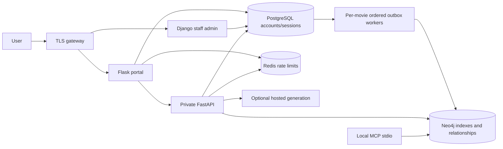

# GraphIntel AI

**Data Analytics & Conversational Intelligence Platform**

GraphIntel AI is a Python portfolio project demonstrating SQL/NoSQL data
management, Neo4j graph intelligence, machine learning, digital analytics,
context engineering and source-grounded conversational GenAI. Django manages
the authoritative catalog and administration, Flask provides the analytics and
exploration portal, and FastAPI serves validated retrieval, recommendation,
RAG and reporting APIs. MCP tools expose graph discovery to compatible clients.

A fictional film catalog is the reference dataset for tracing the complete flow:
SQL ingestion → reliable graph projection → indexed retrieval → explainable
recommendations → cited answers → interaction analytics and CSV reporting.

## Capabilities demonstrated

- **Python and Windows/Linux workflows:** PowerShell/POSIX setup, service
  configuration, container operations and Linux CI configuration.
- **Data engineering and SQL/NoSQL:** PostgreSQL catalog and event data, Neo4j
  relationships, transactional outbox delivery, retries and recovery.
- **Analytics and visualization:** interactive graph and activity views, daily
  aggregates and CSV exports for Microsoft Excel, Power BI or Tableau import.
- **Machine learning and NLP:** TF-IDF text features, graph-based recommendation
  signals, indexed retrieval and a small reproducible relevance evaluation.
- **LLMs, GenAI and context engineering:** bounded retrieved context, explicit
  prompts, citation validation and an optional hosted-model adapter. Local mode
  returns retrieved evidence; generated responses require provider credentials.
- **MCP, Docker, Kubernetes and GitHub CI/CD:** tested MCP stdio tools, hardened
  containers, deployment manifests, health/metrics, security scans and a release
  workflow that scans the image before publishing it.

See the [complete role-to-evidence mapping](docs/skills-matrix.md) and
[reusable project descriptions](docs/project-profile.md). Azure deployment and
model configuration are documented integration paths. Spark/Databricks,
TensorFlow/Keras/CUDA, OpenCV, TensorFlow.js and Cosmos DB are scoped extensions;
they are not dependencies or completed implementations in this project.

The source directory, Python package, CLI commands, environment variables and
Docker identifiers retain `cinegraph` for installation compatibility. GraphIntel
AI is the public project name throughout the application and documentation.

## Run locally

Requires Docker Compose and Python 3.12+ for configuration generation:

```sh
cd cinegraph-ai
python scripts/configure.py --local
docker compose up --build -d
docker compose exec catalog python manage.py createsuperuser
```

The commands work in PowerShell and POSIX shells (`python3` may be needed on
Linux/macOS). Configuration generation preserves database credentials and creates
private random service/session secrets. It never prints secrets. All local
published ports bind to loopback.

Open **http://localhost:5100/login** and sign in with your Django account. Django
admin is **http://localhost:8101/admin/**. An operator account was created during
this workspace's setup; its private credentials are in `.local-admin.json`, which
is ignored by Git. Future installations use `createsuperuser` above.

| Service | Local address | Access |
| --- | --- | --- |
| Flask dashboard | http://localhost:5100 | Django account + database-backed session |
| Django admin | http://localhost:8101/admin/ | Staff account with model permissions |
| FastAPI | http://localhost:8100 | Server-side bearer service credential |
| API liveness/readiness | `/live`, `/ready` | Minimal unauthenticated probe responses |
| Neo4j Browser | http://localhost:7475 | Credentials from local `.env` |

The development catalog contains 24 **fictional sample films**, visibly labelled
in the dashboard. Production initialization does **not** seed sample data.
Projection is asynchronous; a fresh sample catalog appears after the worker
processes its events. Production service credentials never reach browser code.

```sh
docker compose ps
docker compose logs --tail=80 init worker api
docker compose exec catalog python manage.py worker_health
docker compose down  # Retains your database volumes
```

## What changed from the first version

- Dashboard login uses Django accounts, revocable database sessions, an absolute
  eight-hour expiry, CSRF protection, and secure production cookies. Password
  changes and account deactivation invalidate sessions. Analytics is staff-only.
- API endpoints, schema/docs, metrics and operational status require a service
  bearer key. Redis counters enforce API/chat and login quotas across workers;
  protected requests fail closed if Redis is unavailable.
- Production startup rejects insecure/missing credentials, debug mode, anonymous
  access, SQLite, and invalid HTTPS origins. See [security controls](docs/security.md).
- Graph delivery is ordered **per movie**. Other movies continue while one retries
  or becomes a dead letter. Explicit replay, heartbeat, retention and recovery
  commands support operations. Two-worker ordering is integration-tested.
- Full-text indexes and bounded graph candidate queries replace the first-1,000
  movie scan. Search uses cursor pagination. A bounded content-fingerprint cache
  reuses TF-IDF matrices and invalidates when fetched content changes.
- RAG evidence and provider output are bounded; provider errors and invalid source
  citations fail explicitly. Without a key, chat clearly reports evidence-only
  excerpts rather than pretending to generate an answer.
- HTTP logs use route templates and request IDs, without query strings, request
  bodies or credentials. Prometheus metrics and operational status are protected.
- TLS gateway configuration, hardened containers/Kubernetes, pinned CI actions,
  dependency/image scanning, SBOM generation and a manually triggered image
  release workflow are included.

## Architecture



SQL remains the source of truth. Graph operations are idempotent and delivered at
least once; retries cannot reorder updates for the same movie. A dead letter is
an ordering barrier until explicitly recovered. Catalog edits use Django admin
or model saves; bulk SQL/`QuerySet.update()` bypasses the outbox and is unsupported.

## Verify and develop

```sh
uv sync --frozen --extra dev
uv run ruff check .
uv run pytest -q
# Database and real MCP tests (start local databases first):
uv run --env-file .env --env-file .env.integration pytest -q
uv run pip-audit --local --skip-editable
uv run cinegraph-evaluate
uv run --env-file .env python scripts/smoke.py
```

The integration file sets test mode and disables ordinary route authentication;
specific security tests explicitly enable and exercise it. Real Redis tests use
`CINEGRAPH_TEST_REDIS_URL=redis://localhost:6388/15`. Never point tests at production.

Native development uses the local Compose databases:

```sh
uv run --env-file .env python scripts/initialize.py
uv run --env-file .env uvicorn cinegraph.api.app:app --host 127.0.0.1 --port 8100
# Separate terminals; stop the equivalent Compose app service to free its port:
uv run --env-file .env flask --app 'cinegraph.dashboard.app:create_app' run --port 5100
uv run --env-file .env python manage.py runserver 127.0.0.1:8101
uv run --env-file .env python manage.py sync_graph --watch
```

## Deployment and operations

- [Production deployment and upgrade](docs/deployment.md)
- [Security model and trust boundaries](docs/security.md)
- [Operations, recovery and monitoring](docs/operations.md)
- [Hosted AI and MCP configuration](docs/ai-and-mcp.md)
- [Verification evidence and limits](docs/verification.md)
- [Job requirement mapping](docs/skills-matrix.md)

Production controls are implemented and tested locally. Actual public TLS,
cloud infrastructure, Kubernetes rollout, organizational access policies and
long-duration capacity still require environment-specific acceptance testing.
